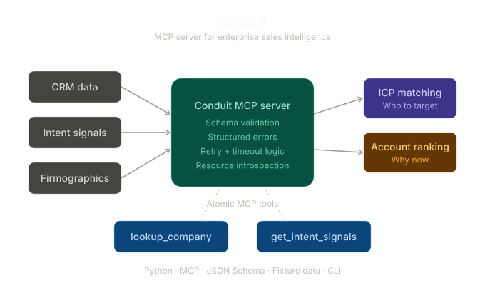

# Conduit



**A Python-based Model Context Protocol (MCP) server for enterprise knowledge management**

Conduit is a custom MCP server with schema-validated tools and structured error handling, built to demonstrate how AI agents can reliably access enterprise data through standardized, secure interfaces.

## What It Does

Conduit exposes atomic tools for enterprise data operations — `lookup_company` (firmographic retrieval by domain or name) and `get_intent_signals` (intent signal retrieval by entity and time window) — backed by fixture data and validated against defined input/output schemas. The use case is to help sales teams answer: "Which companies should we target, and why now?"The server implements a structured error taxonomy, timeout handling, and retry logic. It also exposes MCP resources (schema definitions and signal-source catalogs) that clients can introspect at runtime. A companion CLI client provides smoke-test coverage for both the happy path and error cases.

## Why I Built It

Enterprise buyers don't adopt AI tools they can't trust. Before they ask "what can it do?" they ask "what happens when it breaks?" Conduit is my answer to that question — a working server that degrades gracefully, returns machine-readable errors, and gives security and engineering reviewers a clear contract to evaluate. The project mirrors how I approach technical POCs: start with reliability and a clean API surface, then layer capabilities on top.

## Architecture

```
conduit/
├── server-mcp/          # Custom MCP server (Python)
│   └── fixtures/        # Deterministic mock data for offline demos
├── client-cli/          # MCP client for smoke testing + demo
└── docs/                # Protocol map, tool schemas, error contract
```

## Key Technical Highlights

- **Python MCP Server** with schema-validated tool definitions following the Model Context Protocol specification — tools, resources, and transport lifecycle
- **Structured error contract** with typed error codes (`invalid_input`, `not_found`, `rate_limited`, `provider_down`, `internal_error`), consistent response shapes, and documented failure modes
- **Timeout and retry helpers** designed for real-world API integration scenarios where upstream providers are unreliable
- **MCP resource support** for runtime schema introspection, enabling clients to discover capabilities programmatically
- **Fixture-backed tools** for deterministic, offline-runnable demos — repeatable POC environments tailored to a prospect's data model
- **Documented protocol map** covering MCP concepts (tools vs. resources, schemas, transport, lifecycle)

## Getting Started

```bash
# Clone the repo
git clone https://github.com/dfrho/conduit.git
cd conduit

# Run the MCP server
cd server-mcp
# (follow setup instructions in docs/)

# Run the CLI client smoke tests
cd ../client-cli
# (follow setup instructions in docs/)
```

Refer to `docs/mcp_protocol_map.md` for a walkthrough of MCP concepts and `docs/tool_schemas.md` for tool input/output definitions.

## Roadmap

The project is actively expanding toward:

- **Macro-orchestration workflow** — a single tool call that chains ICP extraction → audience generation → account ranking, returning structured rationale and audit trails
- **CLI agent with guardrails** — tool allowlists, max-call budgets, and a planner that routes to atomic or macro tools with a deterministic eval mode
- **LangSmith integration** — end-to-end tracing, datasets with custom evaluators, and experiment-driven prompt iteration for measurable quality improvement

## Stack

Python · Model Context Protocol (MCP) · JSON Schema · Fixture Data · CLI Tooling
